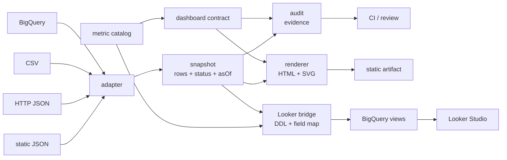

# Architecture

Argus Harness is a portable metric layer with two consumers: a static dashboard
renderer and a Looker Studio / BigQuery export. The same metric catalog and
snapshot feed both.

## Modules

| Module | Responsibility | Effects |
| --- | --- | --- |
| `schema.mjs` | Validate and normalize metric, source, dashboard, snapshot, evidence, project and pack documents. | None |
| `calendar.mjs` | Real UTC days, trailing windows, day ranges. | None |
| `format.mjs` | Units, values, dates, windows. | None |
| `series.mjs` | Normalize history, split gaps, ticks, growth, sparkline data, CSV. | None |
| `sources.mjs` | Load a source into a snapshot. Static/CSV read files; HTTP fetches; BigQuery runs `bq`. | Bounded reads; explicit network/CLI |
| `bigquery.mjs` | Validate identifiers, build the long-format query, invoke `bq`. | `bq` CLI |
| `audit.mjs` | Compare the dashboard, catalog, source and snapshot. | None |
| `render.mjs` | Render the dashboard and page as HTML/SVG. | None |
| `looker.mjs` | Generate BigQuery DDL/views and a field map. | None |
| `project.mjs` | Load a project, resolve paths, validate references. | Filesystem |
| `cli.mjs` | Commands and exit codes. | Filesystem; optionally network/`bq` |

The browser demo imports `schema`, `render`, `audit`, `looker` and `format` only.
It does not import `sources`, `project` or `bigquery`; those are Node-side.

## Data flow

1. `loadProject` validates every metric, source and dashboard and resolves
   dashboard metric references.
2. `loadSnapshot` selects the dashboard source, reads or queries it, normalizes
   rows and returns an `argus.snapshot/1`.
3. `auditDashboard` compares the snapshot with the source budget, dashboard
   window and metric catalog.
4. `renderDashboard` renders the same snapshot. It never calls a source.
5. `looker` writes a warehouse layer from the catalog. It does not read a
   snapshot.

## Boundaries

- **Host owns auth.** The harness has no login, allowlist, secret store or
  session. HTTP headers reference environment variables; the host supplies them.
- **Host owns collection.** The adapter receives rows. It does not decide which
  events are valid; that belongs to the source's SQL or parser.
- **Host owns deployment.** The CLI writes files. A host decides where to serve
  the artifact and whether a report is published.
- **The audit is not a data-quality certification.** It checks declared contracts
  and supplied rows, not source correctness or event completeness.

## Static rendering

The renderer produces one HTML fragment with inline CSS. Charts are SVG with a
`viewBox` and no runtime JavaScript. KPI sparklines, line/area charts, bars, rows,
tables and status details are all static. This keeps the artifact printable,
cacheable and easy to audit. A future client renderer can add tooltips and a date
explorer without changing the contracts.

## Looker Studio

The Looker bridge is a writer, not a connector. It emits:

- `bigquery.sql` — catalog, daily rows, status, latest view, daily view and
  health view.
- `looker-fields.csv` / `.json` — labels, units, semantic types, default
  aggregation and descriptions.
- `README.md` — application steps and limits.

Looker Studio connects to the BigQuery views with its own data source. The
harness and Looker share keys, units and null semantics, not a runtime.

## Failure behavior

| Failure | Behavior |
| --- | --- |
| Missing project file | `doctor` and CLI fail with the path. |
| Invalid contract | `loadProject` fails before rendering. |
| Unknown dashboard metric | `loadProject` fails. |
| HTTP source error | Snapshot `unavailable`, null values, detail. Audit fails. |
| `bq` missing | Snapshot `unavailable`, BigQuery detail. Audit fails. |
| Empty source | Null KPIs and charts; no zeros. |
| Stale source | Values remain, status `stale`, freshness warning or failure. |
| Gap | Chart segment break, table `—`, audit warning. |
